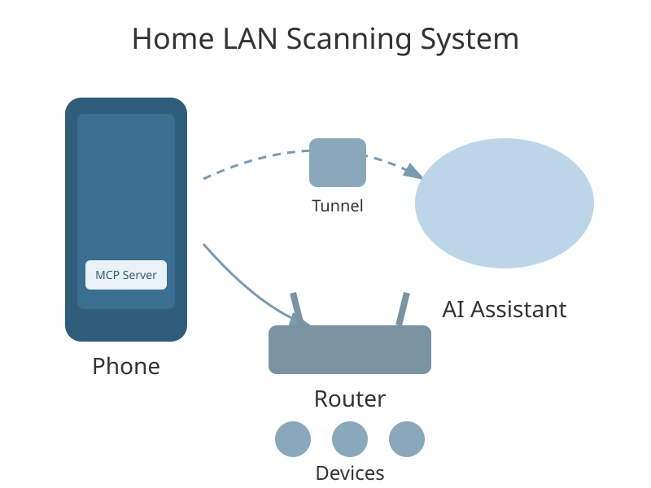
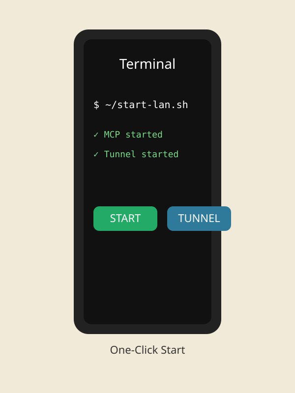
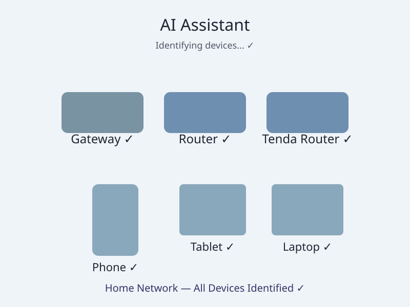

# SentinelMind

> SentinelMind 是 AI 驅動的手機網路巡檢工具，會識別、會判斷、會解釋，不只是列端口的掃描器。核心就是 AI 的能力，不再只是 MCP 伺服器。MCP 只是底層連接 AI 和手機的協議，使用者拿到手的，是一台能巡檢網路的手機，檢查細到審計級。
>
> 不用買硬體，手機就是巡檢設備：不用另外買設備、不用部署硬體，你口袋裡的手機就是巡檢設備。

[](https://www.python.org/)
[](https://modelcontextprotocol.io/)
[](LICENSE)
[](https://termux.dev/)

[English version](README.md)

## 這是什麼

這是 SentinelMind，AI 驅動的手機網路巡檢工具。手機本身就是巡檢設備：它跑在 Android 手機上，AI 助手透過手機去巡檢網路，AI 是核心，負責識別設備、判斷風險、解釋結果，不只是列端口，檢查細到審計級，不再以 MCP 伺服器來定位，也不再只是小小的內網掃描。它讓 AI 助手掃描、識別家裡內網的設備，檢查主機的開放服務和外洩密碼，登入路由器後唯讀查看資訊，檢查附近 WiFi 的加密方式，還能做手機本地檢查，而不用把內網設備直接暴露給外網。底層連接用的是 MCP（模型上下文協議），但那只是實現方式，不是產品本身。

簡單說：手機本來就連著家裡 Wi-Fi，手機跑伺服器，遠端的 AI 助手連到手機，手機再幫它做內網的工作。

這個做法適合 AI 助手本身不在家裡、打不到 `192.168.x.x` 這類內網地址的情況。手機就是遠端 AI 和家裡內網之間的一座橋。

## 適合誰

新手也可以用。不需要伺服器、不需要 Docker 主機、不需要廠商控制器、不需要另外買硬體。一台 Android 手機、一個家裡 Wi-Fi、一個免費 ngrok 帳號就夠了。

會在終端機裡打幾個命令就夠了。下面每一步都按順序寫出來，從零開始。

## 能做什麼

- 掃一個內網網段，列出活著的主機和開放的端口。
- 用 banner、HTTP 標題、SSDP、mDNS 識別主機。
- ping 主機、探測 TCP 端口。
- 對內網地址發一次 HTTP POST（例如路由器登入頁）。
- 登入路由器網頁後唯讀取回一頁，同一次伺服器內呼叫完成（`auth_fetch`）。會話 Cookie 只在伺服器內部用，不回值、不存檔。
- 共 18 個工具（v1.7.1 重大更新）：`device_info, lan_scan, ping, tcp_ports, banner, web_audit, audit_host, mqtt_probe, web_cred_context, http_probe, raw_probe, ssdp_probe, mdns_probe, identify_host, http_post, auth_fetch, router_clients, shell`。`identify_host` 會多路徑探測 80 和 8080 並比對指紋（例如 80 的 frmLoad JS 殼加上 8080 的 `no_cmd_match` JSON 回應，指向電信光貓家族），`router_clients` 是登入後唯讀抓路由器客戶端列表，手機 ARP 表為空時，這才是 MAC 的準確來源，`shell` 則是在手機本機跑一條 shell 命令。`device_info` 現在會回 `network_mode`（內網是 `lan`，移動網絡是 `non_lan`）；移動網絡下內網掃描不能用，但本地工具（`device_info`、`shell`）還能用。公網地址預設一律拒絕，只有機主明確開開關才能用（啟動時設 `MUSE_ALLOW_PUBLIC=1`，或在手機上建一個空的 `~/.lan_mcp_allow_public` 文件），用完必須再關掉。

## 操作圖片

下面三張是示意圖，不是真實截圖，圖裡的命令不用照抄，真正要跑的命令以本文為準。







## 第 1 步：安裝 Termux

Termux 是 Android 上的終端機 App，不需要 root，就能在手機上跑一個 Linux 環境。

1. 從 F-Droid 安裝 Termux（建議用 F-Droid，Play 商店版比較舊）。打開 Termux 一次，讓它完成第一次設定。
2. 更新套件清單：
   ```
   pkg update && pkg upgrade -y
   ```

## 第 2 步：安裝 Python

在 Termux 裡跑：
```
pkg install -y python
python3 --version
```
需要 Python 3。其他 Python 套件都不需要：伺服器只用 Python 標準庫。

## 第 3 步：取得這些檔案

在 Termux 裡下載這個倉庫，兩種方法都可以：

方法 A，用 git：
```
pkg install -y git
git clone https://github.com/Devinkang666666/muse-lan-mcp.git
cp muse-lan-mcp/muse_lan_mcp.py ~/
cp muse-lan-mcp/start-lan.sh ~/
```

方法 B，不用 git：從 GitHub 頁面下載倉庫 ZIP，解壓後把 `muse_lan_mcp.py` 和 `start-lan.sh` 複製到 Termux 家目錄（`~`）。

做完這一步，`~/muse_lan_mcp.py` 和 `~/start-lan.sh` 都要存在。

## 第 4 步：建立一個令牌

伺服器經隧道對外時需要一個 Bearer 令牌。令牌就是手機主人自己定的一個長密碼，絕對不要分享、不要寫進公開倉庫、不要發給別人。

在 Termux 裡建立令牌檔（把範例值換成自己定的長隨機值）：
```
printf 'your-long-random-token-here' > ~/.lan_mcp_token
chmod 600 ~/.lan_mcp_token
```
`start-lan.sh` 啟動時會讀這個檔。為了相容舊設定，如果 `~/.lan_mcp_token` 不存在，它也會接受舊檔名 `~/.hark_token`。

## 第 5 步：安裝 ngrok

ngrok 會給一個公開隧道地址，轉到本地 8765 端口的 MCP 伺服器。免費 ngrok 帳號一次只能佔一個隧道，夠用了。

1. 從 ngrok 官網下載頁選 Android ARM64 版。Termux 套件倉庫裡沒有 ngrok，不要用 `pkg install ngrok` 找。
2. 解壓後把 `ngrok` 放到 Termux 能找到的路徑，例如 `~/../usr/bin/ngrok`，再跑：
   ```
   chmod +x ngrok
   ```
3. 註冊免費 ngrok 帳號，登入後到 Dashboard 的 Your Authtoken 頁，複製自己的 authtoken。這個碼是自己的，不要分享、不要寫進公開倉庫。
4. 在 Termux 裡配 authtoken（把佔位換成真的 authtoken）：
   ```
   ngrok config add-authtoken <你自己的 authtoken>
   ```
   配好後碼只存在手機上 `~/.config/ngrok/ngrok.yml` 裡。

## 第 6 步：一鍵啟動

在 Termux 裡跑：
```
chmod +x ~/start-lan.sh
~/start-lan.sh
```
這個腳本會：
- 先停掉舊隧道（免費帳號一次只能佔一個域名，起第二條會報 `ERR_NGROK_334`），
- 後台啟動 MCP 伺服器，已經在跑就沿用，不重複起，
- 後台啟動 ngrok 隧道到 8765 端口，
- 印出 `started tunnel` 行，裡面有一個像 `https://....ngrok-free.dev` 的公開地址。

那個公開地址，加上第 4 步的 Bearer 令牌，就是 AI 助手要連的東西。隧道地址後面加上 `/mcp`，例如 `https://....ngrok-free.dev/mcp`，就是 MCP 端點。

用完要停，跑：
```
~/start-lan.sh stop
```
隧道和 MCP 都不要長期開著。

## 第 7 步：接上 AI 助手

在任何支援 MCP 的 AI 助手裡，加一個遠端 MCP 伺服器：
- URL： 第 6 步的 ngrok 隧道地址，後面加上 `/mcp`，
- Authorization 標頭： `Authorization: Bearer <第 4 步的令牌>`。

然後就可以叫助手掃內網了。掃的時候一定要明確指定家裡網段，例如：
```json
{"subnet": "192.168.1.0/24"}
```
不要靠預設網段：如果手機走了 VPN / Warp 等虛擬路徑，預設網段可能變成虛擬網段，掃出全開假象。

## 檔案

- `muse_lan_mcp.py`：MCP 伺服器本體。純 Python 標準庫。監聽 `0.0.0.0:8765`，路徑 `/mcp`，JSON-RPC 2.0。
- `start-lan.sh`：MCP 伺服器＋ngrok 隧道的一鍵啟動和停止。裡面不含任何令牌、密碼、隧道域名。令牌只在啟動時從檔案讀。
- `images/`：說明文件的 SVG 示意圖。
- `LICENSE`：MIT 授權。
- `SECURITY.md`：安全政策。

## 安全硬線

- 預設只接內網：公網 IP 一律拒絕，主機名只在解析到私有／回環地址時才放行；只有機主明確開開關（啟動時設 `MUSE_ALLOW_PUBLIC=1`，或建 `~/.lan_mcp_allow_public` 空文件）才能連公網，用完必須再關掉。
- 認證：環境變數 `MUSE_TOKEN` 有值時，必須帶 `Authorization: Bearer <MUSE_TOKEN>`，否則回 401。經 ngrok 對外時務必設令牌，不要空跑。
- 登入後唯讀：`auth_fetch` 登入後只做 GET，不改任何設備設定。不要用 `Set*` 類接口。
- 密碼處理：登入密碼只在呼叫時傳，伺服器內部轉 MD5（如果接口需要），不寫進檔案、不寫進日誌，頁面片段裡的密碼會被遮罩。
- 機密：令牌、密碼、Cookie 值、authtoken、隧道域名，一律不要寫進公開倉庫、不要發給別人。每個人掃的是自己的內網，不是別人的。

## 兩種模式：安全審計模式和全權模式

提醒：SentinelMind 有兩種模式，不要混在一起。

- **安全審計模式：** 上面那 18 個工具，走 MCP 協議。這是預設、建議的模式。它把實測過的經驗（指紋比對、登入後唯讀、密碼遮罩、預設只接內網）包成現成的工具，而且有安全邊界，只審計、不改設備設定。
- **全權模式：** 直接控制 Termux。`shell` 工具可以在手機本機跑一條 shell 命令，直接連 Termux 更是什麼 Termux 命令都能跑。全權模式更快、更自由，但是全權，能改也能刪，只能用在自己擁有的手機上，只有需要完全控制的時候才用，用完要停隧道。

一句話：平常審計用安全審計模式，只有需要完全控制的時候才用全權模式。

### 哪種 AI 能用哪種模式

- **安全審計模式（普通模式）：任何支援遠端 MCP 的 AI 助手都能用。** AI 那邊不需要自己帶電腦，只要能加一個遠端 MCP 伺服器，填隧道地址加 `/mcp`，再填 Bearer 令牌，就能用。例如 Claude Desktop、Cursor、VS Code Copilot，以及其他支援遠端 HTTP MCP 的助手。如果一個 AI App 只有對話框、沒有地方加 MCP 伺服器，那就用不了這個模式。
- **全權模式：只有 agent 才能用。** agent 的意思就是不只是對話，還能動手：能跑命令、能調工具、能在自己的環境裡執行東西。例如 Muse、Claude Code、Cursor 的 agent 模式、Codex 這類寫程式的 agent。純對話的 AI 就算連得進來，也沒辦法自己驅動 Termux 命令，全權模式對它就沒用。
- **用不了的情況：** 只支援本地 stdio MCP、不支援遠端 HTTP 的 AI，不能直接用隧道地址連進來；完全不支援 MCP 的 AI，兩種模式都用不了。

## 使用範例

審計要按順序做，每一步都要留下證據，不要只憑一個信號就下定論：

1. 先確認手機在內網：`device_info` 必須顯示 `network_mode: "lan"` 和私有內網 IP。移動網絡下顯示 `non_lan`，內網工具不能用，但 `device_info` 和 `shell` 還能用。
2. 明確指定網段掃描：`lan_scan` 帶 `{"subnet": "192.168.1.0/24"}`，先列出活著的主機和開放端口，再談這台是什麼。
3. 識別主機：`identify_host` 會多路徑探測 80 和 8080 並比對指紋。家族級結果（例如電信光貓家族）不是精確型號，精確型號只能從登入後的版本頁或設備貼紙確認。
4. 審計主機：`audit_host` 檢查未登入就能看到的開放服務和外洩密碼。結果為空，意思只是未登入看不到東西，不代表固件或配置就是安全的。
5. 登入後讀路由器客戶端列表：`router_clients` 登入後唯讀抓列表，這才是 IP、MAC、主機名的權威來源，因為 Android Termux 讀不到手機 ARP 表（見已知問題）。
6. 檢查附近 WiFi：手機上跑 `termux-wifi-scaninfo`（需要裝 Termux:API App 並開定位權限），能列出附近 SSID、信號、加密方式。已經連過、保存過的 SSID，手機就算在隱藏狀態下也可能報出來，所以「是不是隱藏」必須到路由器設定頁的對話框裡確認，不能只看手機掃描。
7. 用完要停：`~/start-lan.sh stop`，如果開過公網開關，要把 `~/.lan_mcp_allow_public` 文件刪掉。

## 已知問題與解法

這些都是在 Android / Termux 實測中真正遇到過的問題，寫在這裡是為了讓下一個人不重複踩坑：

- **隧道域名已被佔用（`ERR_NGROK_334`）。** 原因：免費 ngrok 一個帳號同一時間只能有一條隧道，第二條同域名會撞。解法：先停舊隧道（`~/start-lan.sh stop` 或 `pkill ngrok`），再重起，不要在免費版上開隧道池化。
- **ngrok 查不到自己的伺服器（`lookup ... on [::1]:53: connection refused`）。** 原因：Termux 的死解析器 `[::1]:53` 不回應。解法：寫 `~/resolv.conf`，裡面是家裡路由器地址加一個公共 DNS，再用 `proot -b ~/resolv.conf:/etc/resolv.conf` 起 ngrok。`start-lan.sh` 已經是這樣起的。
- **隧道心跳超時、公開地址回 HTTP 404。** 原因：隧道會話斷了（換網、斷 WiFi、移動網絡不穩），但本地 MCP 進程還在跑。只看 `start-lan.sh` 印出「完成」不能證明隧道通了。解法：要看到 `~/ngrok-lan.log` 裡新鮮的 `started tunnel` 那一行，並且遠端 `device_info` 能成功，才算通；不通就先 `~/start-lan.sh stop` 再 `~/start-lan.sh`，而且要在穩定的 WiFi 下做。
- **掃出來每台主機每個端口都開。** 原因：手機走了 VPN / Warp 虛擬路徑，預設網段變成虛擬網段，不是家裡內網。解法：永遠明確指定家裡網段，並且先看 `device_info`。
- **掃描結果裡 MAC 全是空的。** 原因：Android 沙盒 / SELinux 擋住 Termux 讀 `/proc/net/arp`（`Permission denied`）和 `ip neigh`，這是平台限制，不是代碼漏寫。解法：登入路由器後用 `router_clients` 拿權威 MAC。
- **路由器同一個密碼，登入一次成功、下一次又失敗。** 原因：有些路由器（實測 Tenda）只允許一個在線會話，或者連續失敗後會鎖定。一次失敗不能證明密碼錯了。解法：先看登入資訊接口的鎖定狀態和剩餘次數，等鎖定解除再試一次，不要暴力試。
- **路由器設定頁只看到總覽，打不開詳細對話框。** 原因：設定頁是圖標格子，詳細對話框只有點中那個具體圖標才會開，點到外層文字容器只會回到總覽。解法：要點中具體圖標（例如「無線名稱與密碼」），並以對話框裡的欄位為準，不要以總覽來下結論。
- **Termux:API 命令超時、沒有輸出。** 原因：`termux-api` 包裝了，但配套的 Termux:API Android App 沒裝（Termux:X11 是另一款 App，是圖形顯示器，不是 API App）。解法：裝跟 Termux 簽名匹配的 Termux:API App（F-Droid 版 Termux 就裝 F-Droid 版），再開定位權限；沒開定位，SSID 會報 `<unknown ssid>`，MAC 會報 `02:00:00:00:00:00`。
- **複製了新文件，更新卻沒生效。** 原因：`start-lan.sh` 會重用已經在跑的 MCP 進程，不重起。解法：更新後一定要先 `~/start-lan.sh stop` 再 `~/start-lan.sh`，而且要用帶版本號的文件名（例如 `muse_lan_mcp_v171.py`），避免下載資料夾裡同名舊文件蓋錯。
- **識別只能到家族級，定不了精確型號。** 原因：網路搜尋和未登入探測只能分家族，定不了精確型號。解法：家族級結果只寫「疑似」，精確型號只能從登入後的版本頁或設備貼紙確認，不要把家族猜測寫成已確認，也不要用廠商「超級密碼」繞登入。

## 常見問題

- `ERR_NGROK_334`（域名已被佔用）：先 `pkill ngrok` 停掉舊隧道，再跑 `~/start-lan.sh`。腳本啟動時已經是這樣做的。
- `lookup connect.ngrok-agent.com on [::1]:53: connection refused`（ngrok 查不到自己的伺服器）：手機 DNS 壞了。寫一個 `~/resolv.conf`，裡面兩行分別是家裡路由器地址（例如 `nameserver 192.168.1.1`）和一個公共 DNS（例如 `nameserver 223.5.5.5`），然後用 `proot -b ~/resolv.conf:/etc/resolv.conf ngrok ...` 的方式起。`start-lan.sh` 已經是這樣起的。
- 一直不出 `started tunnel`：看 `~/ngrok-lan.log` 裡的 ngrok 錯誤，檢查第 5 步的 authtoken 有沒有配好。
- MCP 起不來：看 `~/muse-lan.log`，檢查 `~/muse_lan_mcp.py` 在不在，檢查第 4 步的令牌檔在不在。
- 掃出來每台主機每個端口都開：網段很可能是 VPN / Warp 虛擬網段，不是家裡內網。按第 7 步明確指定家裡網段。

## 授權

MIT 授權。見 `LICENSE`。
